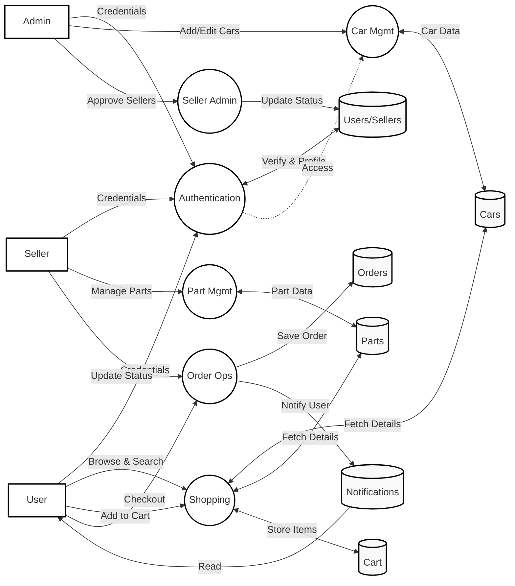

# DFD Level-1: Online Car Recommendation System (Simplified)

This diagram represents the Level-1 Data Flow for the system, designed for simplicity and readability. It follows a linear flow from **Entities** to **Processes** to **Data Stores**.

